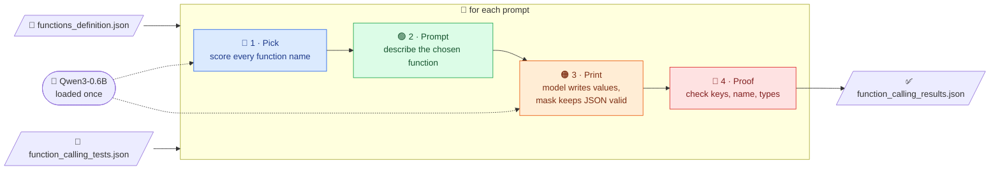
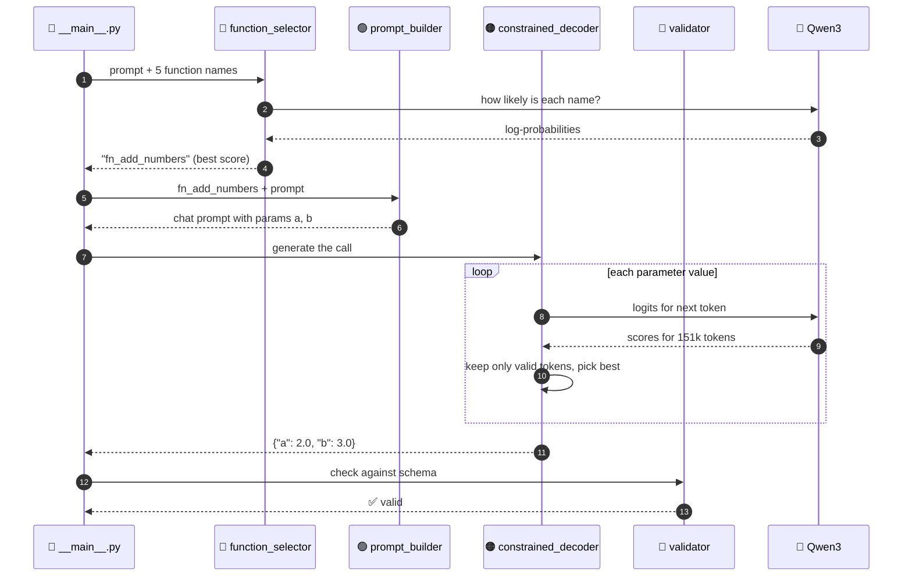
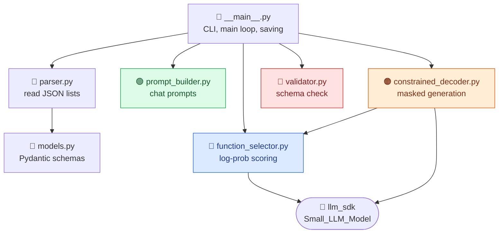

*This project has been created as part of the 42 curriculum by fyousefi.*

<p align="center">
  
  
  
  
  
</p>

<h1 align="center">📞 Call Me Maybe</h1>

<p align="center"><b>A sentence goes in. A valid JSON function call comes out.</b></p>

```
"What is the sum of 2 and 3?"  ──▶  🤖 Qwen3-0.6B  ──▶  {"name": "fn_add_numbers", "parameters": {"a": 2.0, "b": 3.0}}
```

---

## 🗺️ Table of Contents

| | Section | What you'll find |
|---|---------|------------------|
| 📖 | [Description](#-description) | The problem and the idea in one minute |
| ⚙️ | [Instructions](#️-instructions) | Install, run, Make targets |
| 🧭 | [The 4 steps at a glance](#-the-4-steps-at-a-glance) | One diagram of the whole pipeline |
| 🔎 | [One prompt, start to finish](#-one-prompt-start-to-finish) | A real example traced through every file |
| 🧠 | [Algorithm explanation](#-algorithm-explanation) | How the model picks and writes, in detail |
| 🗂️ | [Module map](#️-module-map) | Every file and its one job |
| 🎨 | [Design decisions](#-design-decisions) | Why it is built this way |
| 📊 | [Performance](#-performance-analysis) | Results on the sample data |
| 🧗 | [Challenges](#-challenges-faced) | What was hard and how it was solved |
| 🧪 | [Testing](#-testing-strategy) | How it was checked |
| 📚 | [Resources](#-resources) | References and AI usage |

---

## 📖 Description

Small LLMs are bad at producing valid JSON on request: they forget a bracket,
put a number in quotes, or add a chatty sentence. **Call Me Maybe** fixes that
with **constrained decoding**. The model still decides *everything* (which
function, which values), but at every step it is only *allowed* to write
tokens that keep the JSON valid.

The program receives:

| 📥 Input | Content |
|----------|---------|
| `functions_definition.json` | The **menu**: functions with a name, description and typed parameters |
| `function_calling_tests.json` | The **orders**: plain-English prompts |

and produces:

| 📤 Output | Content |
|-----------|---------|
| `function_calling_results.json` | One `{prompt, name, parameters}` call per prompt |

---

## ⚙️ Instructions

```sh
uv sync                 # install dependencies
uv run python -m src    # run with the default files
```

Custom paths:

```sh
uv run python -m src \
  --functions_definition data/input/functions_definition.json \
  --input data/input/function_calling_tests.json \
  --output data/output/function_calling_results.json
```

| Make target | Does |
|-------------|------|
| `make install` | `uv sync` |
| `make run`      | run the pipeline |
| `make debug`    | run under `pdb` |
| `make lint`     | `flake8` + `mypy` |
| `make clean`    | remove caches |

---

## 🧭 The 4 steps at a glance

Every prompt goes through the same four steps. The colours stay the same in
every diagram below, so you always know which step you are looking at.

| | Step | Who decides | File |
|---|------|-------------|------|
| 🔵 | **Pick** the function | 🤖 the model (log-probability scores) | `function_selector.py` |
| 🟢 | **Prompt** for arguments | 🛠️ the code (builds the question) | `prompt_builder.py` |
| 🟠 | **Print** the JSON | 🤖 the model writes values, 🛠️ the code masks invalid tokens | `constrained_decoder.py` |
| 🔴 | **Proof**-read it | 🛠️ the code (schema check) | `validator.py` |



---

## 🔎 One prompt, start to finish

Let's follow **`"What is the sum of 2 and 3?"`** through the code.



| | Step | In ➡️ | ➡️ Out |
|---|------|-------|--------|
| 📂 | **Load** · `parser.py`, `models.py` | `{"name": "fn_add_numbers", "parameters": {"a": {"type": "number"}, ...}}` | `FunctionDefinition(name="fn_add_numbers", parameters=[a: number, b: number])` |
| 🔵 | **Pick** · `function_selector.py` | prompt + 5 candidate names | `"fn_add_numbers"` |
| 🟢 | **Prompt** · `prompt_builder.py` | `fn_add_numbers` + prompt | chat text: function, description, `a (number)`, `b (number)`, request |
| 🟠 | **Print** · `constrained_decoder.py` | chat text + forced JSON skeleton | `{"prompt": "...", "name": "fn_add_numbers", "parameters": {"a": 2.0, "b": 3.0}}` |
| 🔴 | **Proof** · `validator.py` | the call | keys ✓ · name ✓ · params `{a, b}` ✓ · both numbers ✓ |
| 💾 | **Save** · `__main__.py` | all results | `data/output/function_calling_results.json` |

---

## 🧠 Algorithm Explanation

### 🔵 Pick: how the model chooses a function

The prompt lists every function with its parameters and description, then
asks for *only* the function name. Instead of letting the model write
freely, each candidate name is scored:

```
score(name) = log P(token₁) + log P(token₂ | token₁) + ...
```

| Candidate | Score (example) |
|-----------|-----------------|
| ✅ `fn_add_numbers` | **highest** |
| `fn_substitute_string_with_regex` | lower |
| `fn_greet` | lower |
| `fn_get_square_root` | lower |
| `fn_reverse_string` | lowest |

The highest score wins. The model cannot invent a name that does not
exist, because only real names are ever scored.

### 🟢 Prompt: what the model sees before writing

A second chat prompt describes only the chosen function: its name,
description and each parameter with its type. Three short worked examples
(on made-up functions, not the test data) show the model how to turn words
into literal values, for example *"hashes"* → `#`, *"seven"* → `7.0`.

### 🟠 Print: constrained decoding

The code **forces** the JSON skeleton; the model **writes** the values.

```
{"prompt": "What is the sum of 2 and 3?", "name": "fn_add_numbers", "parameters": {"a": ██, "b": ██}}
└────────────────────────── 🛠️ forced by the code ──────────────────────────────┘        └🤖┘        └🤖┘
```

At every step the model returns a score for each of its ~151k tokens. The
decoder throws away every token that would break the JSON for the current
parameter type, then picks the highest-scoring token that is left:

| Type | ✅ Allowed tokens | 🛑 Value ends when |
|------|-------------------|--------------------|
| `string` | anything that keeps a valid JSON string (escapes like `\\d` included) | the model picks a token containing the closing `"` |
| `number` | digits, `-`, `.` forming a valid number prefix | a `,` or `}` token scores higher than any digit |
| `integer` | digits and `-` | same as number |
| `boolean` | `true` or `false` | the one with the higher log-probability wins |

Example, writing parameter `a`:

```
step 1   model's top tokens:  "2" ✅   "two" 🚫   "\"" 🚫     → write 2
step 2   model's top tokens:  "," 🛑   "." ✅    "0" ✅       → stop, a = 2.0
```

💡 To make this fast, the vocabulary is decoded **once** at startup and
grouped (plain text, escapes, quotes, digits), so building each mask is
a NumPy lookup instead of a scan.

### 🔴 Proof: the final check

Before saving, `validator.py` checks that:

- the keys are exactly `prompt`, `name`, `parameters`
- the name matches the selected function
- the parameter names match the definition
- every value has the right type (`True` is **not** accepted as a number)

If any prompt fails, an error is printed for it and the program moves on
to the next one.

---

## 🗂️ Module Map



| File | One job |
|------|---------|
| 🧩 `__main__.py` | Reads CLI flags, loads the model once, loops over prompts, saves results |
| 📂 `parser.py` | Reads the input JSON files and builds the function models |
| 📐 `models.py` | Pydantic `Parameter` / `FunctionDefinition` (types: string, number, integer, boolean) |
| 🟢 `prompt_builder.py` | Builds the selection prompt and the argument prompt |
| 🔵 `function_selector.py` | Scores function names by log-probability |
| 🟠 `constrained_decoder.py` | Forces the JSON skeleton and masks tokens while the model writes values |
| 🔴 `validator.py` | Checks the final call against the schema |
| 🤖 `llm_sdk` *(provided)* | `encode`, `decode`, `get_logits_from_input_ids`; picks Apple GPU, NVIDIA GPU or CPU |

---

## 🎨 Design Decisions

| Decision | Why |
|----------|-----|
| 🤖 The model makes **every** choice | No regex heuristics on the prompt, so new prompts and functions work too |
| 🎭 Mask tokens, don't trust free text | Malformed JSON becomes structurally impossible |
| 🏗️ Force the skeleton, generate only values | Keys and brackets never cost a model decision |
| 📐 Pydantic for definitions | Bad input files fail early with a clear message |
| 🧑‍🏫 Few-shot examples on unrelated functions | Teaches the small model word → symbol mapping without leaking test answers |
| 🛟 Errors handled per prompt | One bad prompt doesn't lose the other results |

---

## 📊 Performance Analysis

Results on the 11 sample prompts (Apple GPU, about 40–60 s total):

| Property | Result |
|----------|--------|
| ✅ JSON validity | **100%**, guaranteed by the token masks |
| 🔵 Function selection | **11 / 11** correct |
| 🟠 Argument values | **10 / 11** exactly as expected |
| ⏱️ Speed | one forward pass per generated token (the SDK has no KV cache) |

⚠️ **Known limitation:** for *"Replace all vowels … with asterisks"* the
0.6B model writes `"asterisk"` instead of `"*"`. The `*` token is its second
choice. A bigger model, or sampling a few candidates, would fix this. It was
deliberately **not** hardcoded.

---

## 🧗 Challenges Faced

| Challenge | Solution |
|-----------|----------|
| Small model breaks JSON | Force the skeleton, mask every value token by type |
| Masking 151k tokens per step is slow | Decode the vocabulary once, group tokens, use NumPy |
| Tokens like `",` or `+"` merge the closing quote with other text | Treat any token whose first quote closes the string as an "end" token |
| Regex values need backslashes (`\\d+`) | Allow JSON escape sequences inside strings |
| Qwen3 wants to "think" first | Add an empty `<think></think>` block to the prompt |
| Similar functions get close scores | List parameters in the selection prompt to widen the margin |

---

## 🧪 Testing Strategy

```sh
make run     # run on the supplied sample data
make lint    # flake8 + mypy
```

Manually tested: missing files, malformed JSON, invalid schemas, booleans,
quoted strings, negative/decimal numbers, special characters, and extra
paraphrased prompts to check how wide the selection margins are.

---

## ▶️ Example Usage

```sh
make run
```

```
fn_add_numbers → -6.25e-05
fn_greet → -14.09
fn_reverse_string → -16.59
fn_get_square_root → -17.13
fn_substitute_string_with_regex → -14.11

user: What is the sum of 2 and 3?
Selected function: fn_add_numbers
Constrained output: {"prompt": "What is the sum of 2 and 3?", "name": "fn_add_numbers", "parameters": {"a": 2.0, "b": 3.0}}
```

`data/output/function_calling_results.json`:

```json
[
  {
    "prompt": "What is the sum of 2 and 3?",
    "name": "fn_add_numbers",
    "parameters": { "a": 2.0, "b": 3.0 }
  }
]
```

---

## 🃏 The Whole Project on One Card

| 🔵 Pick | 🟢 Prompt | 🟠 Print | 🔴 Proof |
|:-------:|:---------:|:--------:|:--------:|
| model scores names | code describes the function | model writes, mask guards | validator checks |

> *"A small AI reads a sentence, picks the right function, and writes its
> answer in JSON that cannot be invalid."*

---

## 📚 Resources

- [Qwen documentation](https://qwen.readthedocs.io/)
- [Pydantic documentation](https://docs.pydantic.dev/)
- [JSON standard — RFC 8259](https://www.rfc-editor.org/rfc/rfc8259)

**AI usage:** used to review the subject requirements, diagnose the original
slow vocabulary scan, replace the regex argument extraction with masked
constrained decoding, and help draft/test this implementation and README.
Code and the constrained-decoding design were reviewed and verified locally.
